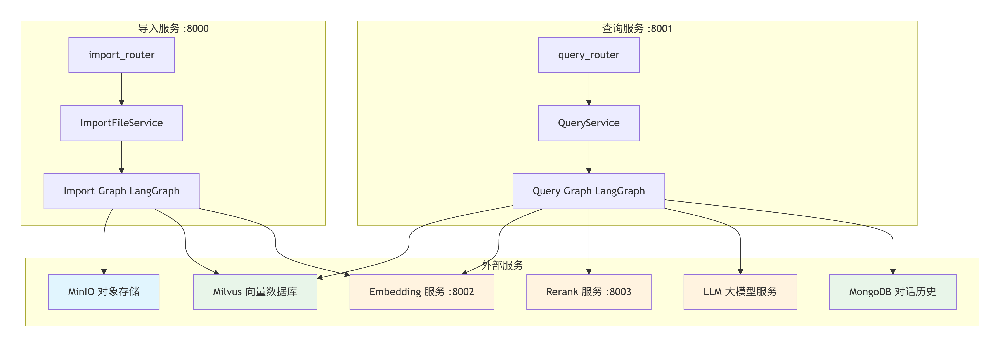
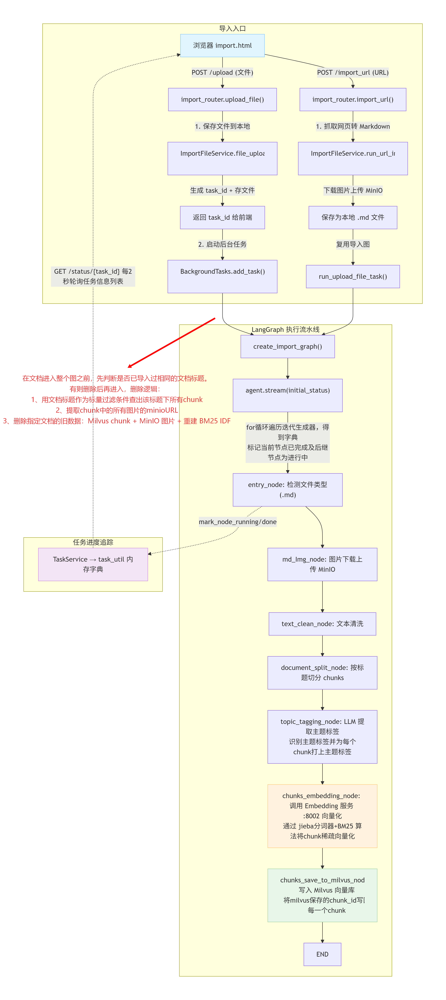
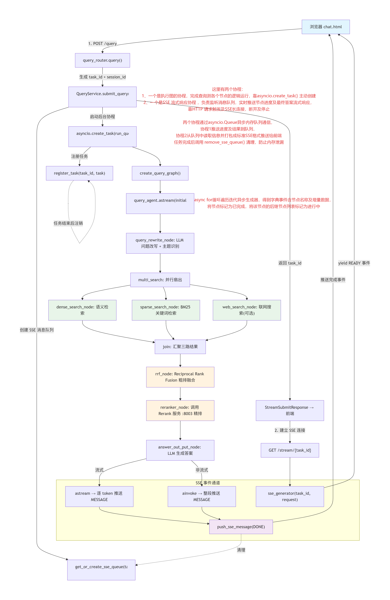
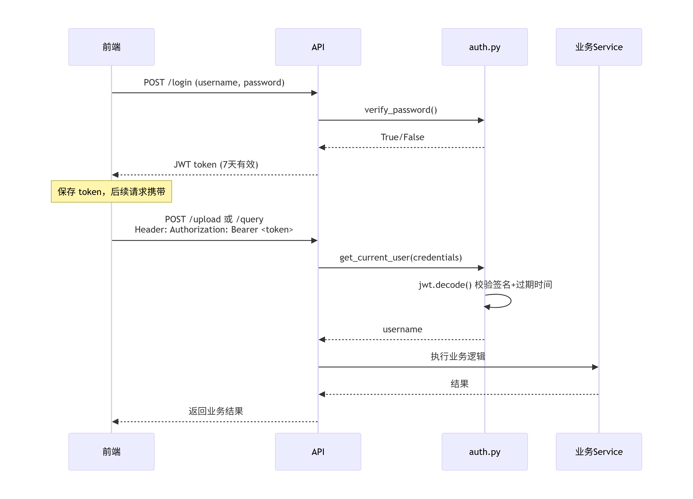

# Second Brain- 个人笔记资料知识库问答系统

一个从 0 到 1 实现的 **个人笔记资料RAG 知识库问答系统**：支持 Markdown / ZIP / 链接三种方式导入文档，经过清洗、切分、向量化后存入向量库；提问时用**多路召回 + RRF 融合 + 精排**检索，再由 LLM 生成带引用来源的答案。检索相关模型（embedding / rerank）**全部私有化部署，纯 CPU 可跑**。

## 技术亮点

1. 基于 LangGraph 的工作流编排

导入端和查询端都采用 **LangGraph StateGraph** 构建有向图工作流，每个处理步骤封装为独立节点（Node），节点之间通过 State 传递数据。这种设计让复杂的多步骤 AI 流程具备了**可视化、可追踪、可调试**的能力——前端能实时看到每个节点的执行状态（运行中/已完成/失败），而不是一团黑盒。

2. 稠密 + 稀疏 + 联网的三路混合检索

查询端不是简单的向量检索，而是同时发起三路搜索：
- **Dense Search**：基于 bge-base-zh 的 768 维语义向量检索（Milvus COSINE 距离）
- **Sparse Search**：基于 jieba 分词 + BM25 的关键词检索（IP 内积）
- **Web Search**：可选的联网搜索补充外部知识

三路结果通过 **RRF（Reciprocal Rank Fusion）** 粗排融合，再经 **bge-reranker-v2-m3 精排**，兼顾召回率和准确性。

3. 双协程架构：asyncio.Queue 实现图执行与 SSE 解耦

查询端没有让 LangGraph 直接往 HTTP 响应里写数据，而是设计了精巧的**生产者-消费者模型**：
- **生产者**：`asyncio.create_task` 启动后台协程执行 LangGraph 图，节点执行结果通过 `push_sse_message()` 写入 `asyncio.Queue`
- **消费者**：SSE 生成器从 Queue 中 `await` 取消息，通过 `StreamingResponse` 推送到前端

这样图执行和 SSE 推送完全解耦，互不阻塞，且前端断开时能通过 `cancel_task()` 立即取消后台协程，**避免继续烧 LLM token**。

4. 智能图片处理分流机制

导入端对图片处理设计了巧妙的分流策略：
- **本地文件导入**：检测 `images/` 目录是否存在，存在则扫描被引用的图片 → 上传 MinIO → 替换 Markdown 中的路径
- **URL 导入**：在抓取阶段就提前下载图片并上传 MinIO，Markdown 中已替换为 MinIO 地址，后续节点检测到无 `images/` 目录直接跳过

通过目录存在性作为信号，**避免了重复上传和重复处理**，设计简洁且幂等。

5. 标题去重与覆盖更新

导入前会按文档标题查询 Milvus 是否已有同名 chunk，如果存在则**先删除旧数据**（包括 Milvus 中的 chunk、MinIO 中的关联图片），再重新导入，并**重建 BM25 IDF 索引**。这保证了同一文档多次导入不会产生脏数据，同时稀疏向量索引始终与语料同步。

   6.完善的任务进度追踪体系

导入端通过内存字典（`task_util`）记录每个 task_id 下各节点的 running/done 状态，前端每 1.5 秒轮询 `/status/{task_id}` 获取进度，配合进度条和日志列表实时展示。查询端则通过 SSE 的 `progress` 事件类型实时推送节点状态。两套机制各自适配场景（导入慢用轮询、查询快用推送），体验流畅。

  7.服务独立部署架构

Embedding 服务（:8002）和 Rerank 服务（:8003）作为独立 FastAPI 应用部署，与导入/查询主服务解耦。好处是模型加载的显存占用隔离、可以独立扩缩容、某个模型服务挂了不影响其他功能。

## 架构图

| 整体架构 | 导入数据流 | 查询数据流 | 登录鉴权 |
|---|---|---|---|
|  |  |  |  |

## 检索 / 问答流程

```
用户提问
   ↓
① query 改写（结合历史对话 + 主题标签）
   ↓
② 三路召回：dense 向量检索 ｜ sparse BM25 检索 ｜ 联网搜索
   ↓
③ RRF 融合（三路结果加权合并去重）
   ↓
④ 精排（bge-reranker-v2-m3 重排序）
   ↓
⑤ 拼接完整上下文 → LLM 生成答案（附来源引用）
```

## 技术栈

| 层 | 技术 |
|---|---|
| 语言 / 框架 | Python 3.10 · FastAPI · LangGraph · LangChain |
| 向量库 | Milvus（dense + sparse 双向量） |
| 检索模型 | bge-base-zh-v1.5（dense）· BM25（sparse）· bge-reranker-v2-m3（精排） |
| LLM | OpenAI 兼容接口（默认 deepseek） |
| 存储 | MongoDB（对话历史）· MinIO（图片对象） |
| 鉴权 | JWT + bcrypt |

## 快速开始（本地）

```bash
# 1. 装依赖（CPU 版 torch）
pip install torch torchvision --index-url https://download.pytorch.org/whl/cpu
pip install -r requirements.txt

# 2. 准备本地基础设施：Milvus / MinIO / MongoDB（自行启动或 Docker）

# 3. 下载模型并配置 knowledge/.env（模型路径、Milvus/MinIO/Mongo 地址、LLM key）
#    参考 knowledge/.env.example

# 4. 启动 4 个服务
python -m knowledge.front.api.import_router   # 8000 导入
python -m knowledge.front.api.query_router    # 8001 查询
python -m uvicorn model_services.embedding_service.embedding_app:app --port 8002
python -m uvicorn model_services.rerank_service.rerank_app:app --port 8003
```

浏览器打开 `http://localhost:8000/import` 登录后即可上传文档 / 导入链接，`http://localhost:8001/chat` 提问。

> 完整部署到 CPU 服务器（阿里云 ECS）的步骤见 **[DEPLOY.md](DEPLOY.md)**。

## 目录结构

```
second-brain/
├── knowledge/                    # 主包
│   ├── front/                    # FastAPI 前端（导入/查询接口、服务、schema）
│   ├── processor/
│   │   ├── import_process/       # 导入流水线（LangGraph 节点：图片/清洗/切分/主题/向量化/入库）
│   │   └── query_process/        # 查询流水线（改写/召回/RRF/精排/生成）
│   ├── prompts/                  # 提示词
│   ├── utils/                    # 工具：embedder、Milvus/MinIO/Mongo 客户端、鉴权等
│   └── topic_taxonomy.py         # 主题标签体系
├── model_services/               # 私有化模型服务（embedding / rerank，FastAPI）
├── tests/                        # 单元测试
├── delete_document.py            # 删除文档脚本（按标题删 chunk + 图片 + 重建 IDF）
├── 图/                           # 架构图
├── requirements.txt
├── DEPLOY.md                     # 部署文档
└── README.md
```

## 测试

```bash
pytest tests/
```
